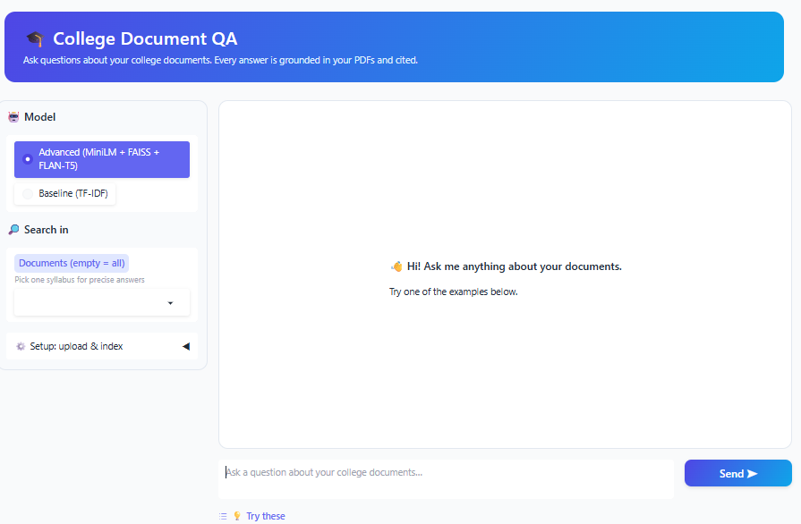

# College Document QA

Ask questions about college PDFs (rules, syllabi, academic calendars) and get an answer **with its document and page citation**.
The project compares two complete question answering pipelines on the same index:

| | Model 1: Baseline | Model 2: Advanced (RAG) |
|---|---|---|
| Retrieval | TF-IDF + cosine similarity | MiniLM sentence embeddings + FAISS |
| Answer | Best passage (extractive) | Short answer generated by FLAN-T5 from the retrieved text |
| "Not found" | Score below a threshold | Score below a threshold, or FLAN-T5 says "not found" |



## Features
- PDF text extraction with exact page numbers; chunks never cross a page boundary, so citations are exact
- Cleaning and masking of e-mails, phone numbers and roll/PRN numbers (person names are **not** removed)
- Gradio chat interface: upload PDFs, build the index, choose the model, see citations and response time
- Evaluation script: Precision@3, Recall@3, MRR, Exact Match, Token F1, ROUGE-L, citation accuracy, handling of unanswerable questions, time, memory, threshold sweep, graphs

## Quick start
Python 3.9 to 3.12 recommended.

```bash
git clone https://github.com/<your-username>/<repo-name>.git
cd <repo-name>
python -m venv venv
venv\Scripts\activate          # Windows
# source venv/bin/activate     # Mac / Linux
pip install -r requirements.txt
```

The first run downloads two models from Hugging Face (about 90 MB for MiniLM and about 1 GB for FLAN-T5-base). A GPU is not required.

```bash
# 1. put your PDFs in data/raw_pdfs/   (or run: pip install reportlab && python make_demo_pdf.py)
python build_index.py      # extract, clean, chunk, build TF-IDF and FAISS indexes
python app.py              # chat at http://127.0.0.1:7860
python -m src.evaluate     # compare both models on eval/test_set.csv
```

## Project structure
```
app.py              Gradio chat interface
build_index.py      builds the indexes from data/raw_pdfs/
make_demo_pdf.py    creates a SYNTHETIC demo PDF (made-up rules) for a smoke test
src/
  config.py         all settings (chunk size, thresholds, model names)
  ingest.py         PDF extraction, cleaning, PII masking, chunking
  retrievers.py     TfidfRetriever and FaissRetriever
  qa_models.py      BaselineQA and AdvancedQA
  system.py         build / load indexes
  metrics.py        EM, F1, ROUGE-L, retrieval metrics
  evaluate.py       evaluation, comparison table, graphs
eval/               test set, results and graphs
```

## Test set format
`eval/test_set.csv` with columns `question, reference_answer, gold_doc, gold_page, answerable`.
`gold_page` is the physical PDF page (use `3;4` for several pages). Set `answerable` to 0 for questions whose answer is not in the documents.

## Results (pilot)
Pilot test set of 11 questions (9 answerable, 2 unanswerable). Nine questions are about a 4-page *synthetic* document; three real syllabi were in the index as distractors.

| Metric | Baseline | Advanced |
|---|---|---|
| Recall@3 / MRR | 1.000 / 1.000 | 1.000 / 1.000 |
| Exact Match | 0.000 | 0.333 |
| Token F1 | 0.108 | 0.668 |
| Correct "not found" on unanswerable | 0.000 | 1.000 |
| Avg response time (s) | 0.009 | 1.824 |

**Read with care:** the test set is very small, so these numbers are indicative only. The baseline returns a whole passage (about 86 words), so Exact Match and F1 favour the short generated answers even though the baseline passage usually contains the answer. Replace this table with results from a larger test set on real documents.

## Limitations
- Text PDFs only (scanned PDFs need OCR); tables and figures are not parsed
- FLAN-T5-base reads at most 512 tokens, so only the first one or two passages are seen
- No notion of programme or year: a question that does not name its document can be answered from the wrong syllabus
- Person names are not masked

## Documents and data
Source PDFs are **not** included in this repository (copyright and privacy). Add your own public or permitted PDFs to `data/raw_pdfs/`. Do not use confidential documents without permission.

## License
MIT, see `LICENSE`.
